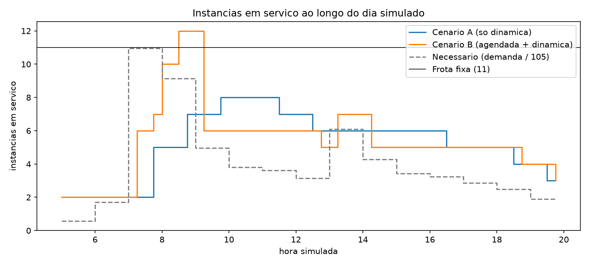

# Elastic Computing com Floci — AgendaSaúde RP

**Grupo:** Vitor Ferraz Marini (837771) · Otavio Ribeiro Moreira da Costa (838807)

Roteiro de autoestudo do AG822 (Unidade X — Auto Scaling e Monitoramento): uma aplicação web atrás de um Application
Load Balancer que ganha instâncias no pico e as devolve quando a demanda cai, rodando inteira no
[Floci](https://floci.io), sem conta AWS.

**Relatório completo: [`relatorio.md`](relatorio.md)** (saídas de terminal de cada etapa e respostas às questões).

| Resultado | |
|---|---|
| Frota fixa × elástica (Etapa 1) | 264 × 88 instâncias-hora/dia → 66,7 % de economia |
| Passos saturados no dia simulado (Etapa 5) | A (só dinâmica): 7 · B (agendada + dinâmica): 4 |
| Custo mensal, t3.micro em São Paulo (Etapa 6) | fixa R$ 358,74 · A R$ 169,59 · B R$ 176,11 (+ R$ 66 de ALB) |



## Arquivos

| Arquivo | O que é |
|---|---|
| `compose.yaml` | Floci com acesso ao socket do Docker (cada instância EC2 é um contêiner) |
| `aws-config`, `aws-credentials`, `env.sh` | Perfil `floci` (credenciais fictícias `test`) só para esta pasta |
| `userdata.sh` | Script de inicialização das instâncias (servidor web com `/health`) |
| `gerador.py`, `controlador.py`, `analisar.py` | Scripts do roteiro (Etapas 5 e 6) |
| `cenario-A.csv`, `cenario-B.csv`, `controlador-A.log`, `controlador-B.log`, `comparativo.png` | Resultados das execuções |

## Como reproduzir

```bash
docker compose up -d
python3 -m venv .venv && .venv/bin/pip install boto3 matplotlib
source env.sh                    # AWS_PROFILE=floci só neste terminal
aws sts get-caller-identity      # conta 000000000000
```

Depois, seguir as etapas do `relatorio.md` em ordem. Requer Docker, AWS CLI v2 e Python 3.10+.
Ao terminar: `aws autoscaling delete-auto-scaling-group --auto-scaling-group-name agenda-web-asg --force-delete` e
`docker compose down`.
