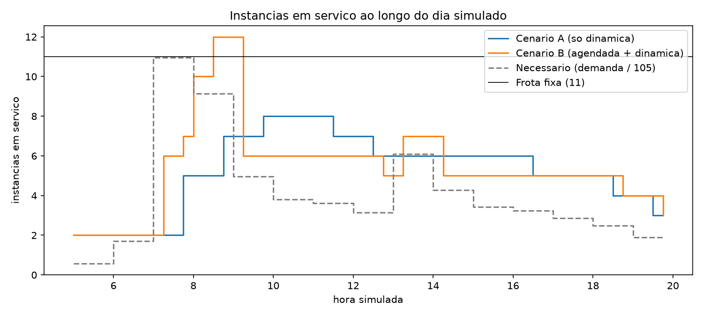

# Relatório — Elastic Computing com Floci (AgendaSaúde RP)

**Grupo:** Vitor Ferraz Marini (837771) · Otavio Ribeiro Moreira da Costa (838807)

Roteiro de autoestudo do AG822, Unidade X (Auto Scaling e Monitoramento). Todo o trabalho rodou no Floci
(`floci/floci:latest`, imagem de 15/11/2026), num notebook Linux com 16 GB de RAM; por isso foi usado o grupo com
**máximo 12** e o fator de demanda **1,0** (o roteiro só pede `--max-size 6` / `--fator 0.5` com 8 GB ou menos).
Cada instância EC2 ocupou ~88 MB de RAM no Docker.

Arquivos entregues junto: `comparativo.png`, `cenario-A.csv`, `cenario-B.csv`, `controlador-A.log`,
`controlador-B.log`.

---

## Etapa 0 — Ambiente Floci

`compose.yaml` do roteiro, com as portas publicadas só em `127.0.0.1` (a API emulada não fica exposta na rede):

```yaml
name: elastic-lab
services:
  floci:
    image: floci/floci:latest
    container_name: floci
    ports:
      - "127.0.0.1:4566:4566"    # API de todos os serviços
      - "127.0.0.1:8080:8080"    # listener do load balancer (Etapa 2)
    volumes:
      - /var/run/docker.sock:/var/run/docker.sock
    environment:
      FLOCI_HOSTNAME: floci
      FLOCI_SERVICES_DOCKER_NETWORK: elastic-lab_default
```

Perfil `floci` igual ao do roteiro (`region = us-east-1`, `output = json`, `endpoint_url = http://localhost:4566`,
credenciais `test`). Em vez de editar o `~/.aws` da máquina, o perfil ficou em arquivos da pasta do laboratório,
apontados por `AWS_CONFIG_FILE` e `AWS_SHARED_CREDENTIALS_FILE`, com `AWS_PROFILE=floci`: assim nenhum terminal fora
desta pasta passa a falar com o emulador, nem esta pasta com uma conta real.

```
$ aws configure list
NAME       : VALUE                    : TYPE             : LOCATION
profile    : floci                    : env              : ['AWS_PROFILE', 'AWS_DEFAULT_PROFILE']
access_key : ****************test     : shared-credentials-file :
secret_key : ****************test     : shared-credentials-file :
region     : us-east-1                : config-file      : ./aws-config   (caminho abreviado)

$ aws sts get-caller-identity
{
    "UserId": "000000000000",
    "Account": "000000000000",
    "Arn": "arn:aws:iam::000000000000:root"
}
```

Conta fictícia `000000000000`, sem erro de credencial: todo comando `aws` desta sessão vai para o Floci.

---

## Etapa 1 — Conceitos e dimensionamento

Capacidade de uma instância: 150 req/min; meta de operação: 70 % → **105 req/min por instância**; mínimo de 2.
Instâncias por hora = máx(2, ⌈demanda ÷ 105⌉). Demanda de cada hora lida do gráfico do roteiro (é o mesmo dicionário
`DEMANDA` do `gerador.py`).

| Hora | Demanda (req/min) | demanda ÷ 105 | Instâncias |
|---|---|---|---|
| 00h | 40 | 0,38 | 2 |
| 01h | 30 | 0,29 | 2 |
| 02h | 25 | 0,24 | 2 |
| 03h | 25 | 0,24 | 2 |
| 04h | 30 | 0,29 | 2 |
| 05h | 60 | 0,57 | 2 |
| 06h | 180 | 1,71 | 2 |
| **07h** | **1150** | **10,95** | **11** |
| 08h | 960 | 9,14 | 10 |
| 09h | 520 | 4,95 | 5 |
| 10h | 400 | 3,81 | 4 |
| 11h | 380 | 3,62 | 4 |
| 12h | 330 | 3,14 | 4 |
| **13h** | **640** | **6,10** | **7** |
| 14h | 450 | 4,29 | 5 |
| 15h | 360 | 3,43 | 4 |
| 16h | 340 | 3,24 | 4 |
| 17h | 300 | 2,86 | 3 |
| 18h | 260 | 2,48 | 3 |
| 19h | 200 | 1,90 | 2 |
| 20h | 150 | 1,43 | 2 |
| 21h | 110 | 1,05 | 2 |
| 22h | 80 | 0,76 | 2 |
| 23h | 55 | 0,52 | 2 |

**2. Frota fixa e economia.** A frota fixa é dimensionada para o pico das 7h: ⌈1150 ÷ 105⌉ = **11 instâncias**.
- Frota fixa: 11 × 24 h = **264 instâncias-hora/dia**.
- Frota elástica (soma da tabela): 2×7 + 2 + 11 + 10 + 5 + 4 + 4 + 4 + 7 + 5 + 4 + 4 + 3 + 3 + 2×5 = **88 instâncias-hora/dia**.
- Economia: 1 − 88 ÷ 264 = **66,7 %** (dois terços das instâncias-hora).

**3. O morador às 7h01.** Se o ASG só reagir à métrica, às 7h00 ainda há as 2 instâncias da madrugada para 1150 req/min:
575 req/min por instância, quase 4× os 150 que cada uma aguenta. O alarme só dispara depois de ao menos um período de
60 s acima do limiar, a instância nova leva ~3 min para entrar em serviço e ainda precisa passar no health check do ALB.
Então, entre 7h00 e ~7h05, quem abre o portal para marcar consulta encontra lentidão e erros justamente no minuto em que
as vagas abrem. **Proposta:** ação agendada às **6h45, mínimo e desejada = 11**, 15 minutos antes do pico, folga de
sobra para o boot (~3 min) e para o health check.

**4. Por que o pico das 13h pede política dinâmica.** Ele varia conforme o número de vagas liberadas no dia: uma ação
agendada tem um número fixo, que num dia fraco desperdiça instâncias e num dia forte fica curto. A política dinâmica
mede a demanda real e ajusta a capacidade dentro dos limites; a agendada serve para dar um piso antes do horário
conhecido, e a dinâmica completa o que faltar.

**5. Por que o mínimo é 2, e não 1.** De madrugada a demanda (25–60 req/min) cabe numa instância, mas uma só é ponto
único de falha: se ela travar, o portal fica fora do ar até o ASG detectar, lançar e aquecer outra (minutos na AWS).
Com 2 instâncias em zonas de disponibilidade diferentes, o ALB continua atendendo pela outra enquanto a substituta sobe,
e uma falha de zona inteira também não derruba o portal.

---

## Etapa 2 — Infraestrutura base

### 2.1 Rede e grupo de segurança

```
$ VPC_ID=$(aws ec2 describe-vpcs --filters Name=is-default,Values=true --query 'Vpcs[0].VpcId' --output text)
$ SUBNETS=$(aws ec2 describe-subnets --filters Name=vpc-id,Values=$VPC_ID --query 'Subnets[*].SubnetId' --output text)
$ echo $VPC_ID $SUBNETS
vpc-default-us-east-1 subnet-default-us-east-1-c subnet-default-us-east-1-b subnet-default-us-east-1-a
$ aws ec2 describe-subnets --filters Name=vpc-id,Values=$VPC_ID --query 'Subnets[*].[SubnetId,AvailabilityZone,CidrBlock]' --output text
subnet-default-us-east-1-c	us-east-1c	172.31.32.0/20
subnet-default-us-east-1-b	us-east-1b	172.31.16.0/20
subnet-default-us-east-1-a	us-east-1a	172.31.0.0/20
$ SG_ID=$(aws ec2 create-security-group --group-name agenda-web-sg --description "Portal AgendaSaude" --vpc-id $VPC_ID --query GroupId --output text)
$ aws ec2 authorize-security-group-ingress --group-id $SG_ID --protocol tcp --port 80 --cidr 0.0.0.0/0 --query Return
true
$ echo "SG_ID=$SG_ID"
SG_ID=sg-bc3094c39d221ec37
```

A VPC padrão do Floci já existe, com três sub-redes em três zonas; não foi preciso criar rede.

### 2.2–2.3 User data e launch template

`userdata.sh` exatamente como no roteiro. Launch template:

```
$ USERDATA=$(base64 < userdata.sh | tr -d '\n')
$ aws ec2 create-launch-template --launch-template-name agenda-web-lt --launch-template-data "{\"ImageId\":\"ami-amazonlinux2023\",\"InstanceType\":\"t3.micro\",\"SecurityGroupIds\":[\"$SG_ID\"],\"UserData\":\"$USERDATA\"}"
{
    "LaunchTemplate": {
        "LaunchTemplateId": "lt-7de2d037805eb9642",
        "LaunchTemplateName": "agenda-web-lt",
        "CreateTime": "2026-11-25T20:44:56.234000+00:00",
        "CreatedBy": "arn:aws:iam::000000000000:root",
        "DefaultVersionNumber": 1,
        "LatestVersionNumber": 1,
        "Tags": []
    }
}
```

### 2.4 Instância de teste

```
$ TEST_ID=$(aws ec2 run-instances --launch-template LaunchTemplateName=agenda-web-lt --count 1 --query 'Instances[0].InstanceId' --output text)
$ echo $TEST_ID
i-8015244276b26020c
$ aws ec2 describe-instances --instance-ids $TEST_ID --query 'Reservations[0].Instances[0].State.Name'
"running"
$ docker ps --format '{{.Names}} {{.Image}} {{.Ports}}'
floci-aws-ec2-i-8015244276b26020c 5c6ed3b38335 0.0.0.0:2200->22/tcp, [::]:2200->22/tcp
floci floci/floci:latest 127.0.0.1:4566->4566/tcp, 127.0.0.1:8080->8080/tcp
```

Linhas do log do Floci (`docker logs floci`) para essa instância:

```
Created container 66360dad… (name=floci-aws-ec2-i-8015244276b26020c, not yet started)
Attached container 66360dad… to VPC network floci-aws-vpc-4566-us-east-1-vpc-default-us-east-1 at 172.31.32.10
EC2 instance i-8015244276b26020c running in container 66360dad… (SSH host port 2200)
Configured link-local IMDS endpoint for EC2 instance i-8015244276b26020c
UserData shellscript part 1/1 completed for EC2 instance i-8015244276b26020c: (no output)
Published EC2 instance i-8015244276b26020c app port 80 on host port 30,000 (socat -> 172.23.0.3:80)
```

Teste da instância de teste, feito ~40 s após o `run-instances`, antes de o redirecionamento existir; por isso o
`curl` foi feito pelo IP do contêiner na rede `elastic-lab_default`:

```
$ curl http://172.23.0.3/
<h1>AgendaSaude RP</h1><p>Atendido por: i-8015244276b26020c</p>
```

O teste pela porta do host (30000–30999) foi feito depois, numa instância do Auto Scaling group da Etapa 3, porque a
instância de teste já tinha sido encerrada:

```
$ docker ps --format '{{.Names}} {{.Ports}}' | grep fwd
floci-aws-ec2-fwd-i-aaed7be2c2e36e523-80 0.0.0.0:30001->80/tcp, [::]:30001->80/tcp
floci-aws-ec2-fwd-i-4200479387b9687b2-80 0.0.0.0:30003->80/tcp, [::]:30003->80/tcp
$ curl http://localhost:30003/
<h1>AgendaSaude RP</h1><p>Atendido por: i-4200479387b9687b2</p>
```

**O que o Floci criou no Docker ao chamar `run-instances`?** Um contêiner real (`floci-aws-ec2-<id>`) a partir da
imagem do Amazon Linux 2023 (a AMI `ami-amazonlinux2023` traduzida), ligado a duas redes: a do compose
(`elastic-lab_default`, 172.23.0.3) e uma rede que representa a VPC (172.31.32.10, dentro da sub-rede 172.31.32.0/20).
Ele publicou o SSH na porta 2200 do host, configurou o endpoint de metadados (por isso a página mostra o ID
`i-…` real, e não o hostname) e rodou o user data. Uns 75 s depois, quando o servidor web já escutava, criou um
**segundo contêiner**, `floci-aws-ec2-fwd-<id>-80`, um `socat` que liga a porta 80 da instância à porta 30000 do host.
Na primeira olhada, feita ~40 s após o `run-instances`, só a porta 2200 aparecia: o redirecionamento da porta 80 chega
depois.

### 2.5 Load balancer

```
$ TG_ARN=$(aws elbv2 create-target-group --name agenda-web-tg --protocol HTTP --port 80 --vpc-id $VPC_ID --target-type instance --health-check-path /health --health-check-interval-seconds 10 --healthy-threshold-count 2 --query 'TargetGroups[0].TargetGroupArn' --output text)
$ ALB_ARN=$(aws elbv2 create-load-balancer --name agenda-web-alb --subnets $SUBNETS --security-groups $SG_ID --query 'LoadBalancers[0].LoadBalancerArn' --output text)
$ aws elbv2 create-listener --load-balancer-arn $ALB_ARN --protocol HTTP --port 8080 --default-actions Type=forward,TargetGroupArn=$TG_ARN
$ aws elbv2 register-targets --target-group-arn $TG_ARN --targets Id=$TEST_ID
$ aws elbv2 describe-target-health --target-group-arn $TG_ARN --query 'TargetHealthDescriptions[*].[Target.Id,TargetHealth.State]'
[
    [
        "i-8015244276b26020c",
        "healthy"
    ]
]
$ curl http://localhost:8080/
<h1>AgendaSaude RP</h1><p>Atendido por: i-8015244276b26020c</p>
```

O ALB responde na porta 8080 e entrega a página da instância criada pelo launch template.

---

## Etapa 3 — Auto Scaling group

### 3.1 Criação do grupo

```
$ aws elbv2 deregister-targets --target-group-arn $TG_ARN --targets Id=$TEST_ID
$ aws ec2 terminate-instances --instance-ids $TEST_ID
"shutting-down"
$ SUBNET_LIST=$(echo $SUBNETS | tr ' ' ',')
$ aws autoscaling create-auto-scaling-group --auto-scaling-group-name agenda-web-asg --launch-template 'LaunchTemplateName=agenda-web-lt,Version=$Latest' --min-size 2 --max-size 12 --desired-capacity 2 --vpc-zone-identifier "$SUBNET_LIST" --target-group-arns $TG_ARN --health-check-type ELB --health-check-grace-period 30
```

Laço de acompanhamento (a cada 5 s), ~25 s depois:

```
2
i-0b39124debe7ef9df	InService	Healthy
i-9cd6ed3002e873b47	InService	Healthy
```

### 3.2 Distribuição de carga

```
$ for i in $(seq 1 20); do curl -s http://localhost:8080/ | grep -o 'i-[0-9a-f]*'; done | sort | uniq -c
     10 i-0b39124debe7ef9df
     10 i-9cd6ed3002e873b47
```

O ALB alternou as requisições entre as duas instâncias (round-robin): 10 para cada.

### 3.3 Escala manual

```
$ aws autoscaling set-desired-capacity --auto-scaling-group-name agenda-web-asg --desired-capacity 4
```

Cronometrado com consultas a cada 2 s: **4 instâncias InService após 17 s** e **4 saudáveis no target group após
69 s** (o health check precisa de 2 sucessos seguidos a cada 10 s, depois que o servidor web sobe).

```
$ aws autoscaling describe-scaling-activities --auto-scaling-group-name agenda-web-asg --query 'Activities[*].[StartTime,StatusCode,Description]' --output table
---------------------------------------------------------------------------------------------------------
|                                       DescribeScalingActivities                                       |
+-----------------------------------+-------------+-----------------------------------------------------+
|  2026-11-25T20:52:27.869000+00:00 |  Successful |  Launching a new EC2 instance: i-4200479387b9687b2  |
|  2026-11-25T20:52:27.869000+00:00 |  Successful |  Launching a new EC2 instance: i-06a9a4bfd3926562a  |
|  2026-11-25T20:48:17.867000+00:00 |  Successful |  Launching a new EC2 instance: i-9cd6ed3002e873b47  |
|  2026-11-25T20:48:17.867000+00:00 |  Successful |  Launching a new EC2 instance: i-0b39124debe7ef9df  |
+-----------------------------------+-------------+-----------------------------------------------------+
$ for i in $(seq 1 20); do curl -s http://localhost:8080/ | grep -o 'i-[0-9a-f]*'; done | sort | uniq -c
      5 i-06a9a4bfd3926562a
      5 i-0b39124debe7ef9df
      5 i-4200479387b9687b2
      5 i-9cd6ed3002e873b47
$ aws autoscaling set-desired-capacity --auto-scaling-group-name agenda-web-asg --desired-capacity 20

aws: [ERROR]: An error occurred (ValidationError) when calling the SetDesiredCapacity operation: New DesiredCapacity=20 must be between MinSize=2 and MaxSize=12.
```

As instâncias novas entraram no target group sozinhas (5 requisições para cada uma das quatro).

### 3.4 Autorrecuperação

```
$ aws ec2 terminate-instances --instance-ids i-9cd6ed3002e873b47   # simulando falha, por fora do ASG (17:56:24)
i-9cd6ed3002e873b47	shutting-down
--- +6s
4
i-0b39124debe7ef9df	InService	Healthy
i-06a9a4bfd3926562a	InService	Healthy
i-4200479387b9687b2	InService	Healthy
i-aaed7be2c2e36e523	Pending	Healthy
--- +12s
(…igual…)
substituta InService após 14s
$ aws autoscaling describe-scaling-activities --auto-scaling-group-name agenda-web-asg --max-items 3 --query 'Activities[*].[StartTime,StatusCode,Description]' --output table
|  2026-11-25T20:56:37.870000+00:00 |  Successful |  Launching a new EC2 instance: i-aaed7be2c2e36e523                |
|  2026-11-25T20:56:27.871000+00:00 |  Successful |  Removing stale EC2 instance reference(s): [i-9cd6ed3002e873b47]  |
|  2026-11-25T20:52:27.869000+00:00 |  Successful |  Launching a new EC2 instance: i-4200479387b9687b2                |
```

**O ASG lançou uma substituta.** Em ~3 s o reconciliador percebeu a instância perdida ("Removing stale EC2 instance
reference"), em ~13 s lançou `i-aaed7be2c2e36e523` e ela ficou InService **14 s** depois da falha. Na AWS o mesmo
ciclo leva minutos: a detecção depende do health check (EC2 ou ELB), a instância nova precisa inicializar e cumprir o
período de carência de 30 s antes de contar como saudável.

Volta para 2 instâncias:

```
$ aws autoscaling set-desired-capacity --auto-scaling-group-name agenda-web-asg --desired-capacity 2   (17:56:48)
$ (40 s depois) describe-auto-scaling-groups / describe-target-health
2
i-4200479387b9687b2	InService	Healthy
i-aaed7be2c2e36e523	InService	Healthy
i-4200479387b9687b2	healthy
i-aaed7be2c2e36e523	healthy
```

Log do Floci na redução (e, de `describe-scaling-activities`, a atividade das 20:56:57.912: `Terminating EC2 instance(s):
[i-0b39124debe7ef9df, i-06a9a4bfd3926562a]`):

```
20:56:57,869 ASG agenda-web-asg: scaling in 2 instance(s)
20:56:58,160 Removed stale container floci-aws-ec2-fwd-i-0b39124debe7ef9df-80
20:56:58,161 Unpublished EC2 instance i-0b39124debe7ef9df app port 80 (released host port 30,000)
20:56:58,175 Removed stale container floci-aws-ec2-fwd-i-06a9a4bfd3926562a-80
20:56:58,175 Unpublished EC2 instance i-06a9a4bfd3926562a app port 80 (released host port 30,002)
```

### Questões

**1. Ordem na redução de 4 para 2.** No Floci, saída do target group e encerramento aconteceram **no mesmo segundo**:
às 20:56:57 o reconciliador decidiu, registrou "Terminating" das duas mais antigas e, 0,3 s depois, removeu os
redirecionamentos de porta; o laço de 5 s nunca mostrou um estado intermediário (`Terminating`/draining). Ele escolheu
as **duas mais antigas** (`i-0b39…`, lançada às 20:48, e `i-06a9…`, às 20:52) e manteve a mais nova. Na AWS a ordem é
outra, e é ela que protege o usuário: o ASG primeiro **tira a instância do target group**, o ALB para de mandar
requisições novas para ela e espera o *deregistration delay* (padrão 300 s) para as requisições em andamento
terminarem; só então a instância é encerrada. Assim ninguém tem a página cortada no meio porque o servidor foi
desligado enquanto respondia.

**2. `--health-check-type EC2` × `ELB`.** O EC2 olha o estado da máquina (instância rodando, checagens de sistema e de
status do hipervisor); um servidor web travado numa máquina ligada passa nele. O ELB usa o health check do target group
(aqui, `GET /health` a cada 10 s) e marca como doente quem não responde HTTP; com `--health-check-type ELB`, o ASG
substitui essa instância. **Só o ELB detecta o servidor web travado**, por isso o grupo foi criado com ele.

**3. Pedir 20 instâncias.** Foi recusado: `ValidationError … New DesiredCapacity=20 must be between MinSize=2 and
MaxSize=12`. O máximo existe como teto de custo e de dano: um bug no controlador, uma métrica errada ou um ataque de
tráfego não podem fazer o grupo crescer sem limite; ele também protege o que fica atrás das instâncias (banco de dados,
licenças) e respeita as cotas de vCPU da conta.

---

## Etapa 4 — Escalonamento agendado

### 4.1 As quatro ações

Desenhadas a partir da tabela da Etapa 1:

| Ação | Recorrência (Brasília) | min | desejada | Motivo |
|---|---|---|---|---|
| pre-pico-manha | 6h45, seg–sex | 11 | 11 | Às 7h são necessárias 11; 15 min de folga para o boot (~3 min) e o health check |
| pos-pico-manha | 9h00 | 2 | 5 | Às 9h bastam 5; o mínimo volta a 2 para a dinâmica poder reduzir ao longo da manhã |
| pre-pico-tarde | 12h45 | 7 | 7 | Às 13h são necessárias 7 (dia ilustrativo); a dinâmica completa se o dia for mais forte |
| pos-pico-tarde | 14h00 | 2 | 5 | Às 14h bastam 5; mínimo volta a 2 |

```
$ aws autoscaling put-scheduled-update-group-action --auto-scaling-group-name agenda-web-asg --scheduled-action-name pre-pico-manha --recurrence "45 6 * * 1-5" --time-zone "America/Sao_Paulo" --min-size 11 --max-size 12 --desired-capacity 11
$ aws autoscaling put-scheduled-update-group-action --auto-scaling-group-name agenda-web-asg --scheduled-action-name pos-pico-manha --recurrence "0 9 * * 1-5" --time-zone "America/Sao_Paulo" --min-size 2 --max-size 12 --desired-capacity 5
$ aws autoscaling put-scheduled-update-group-action --auto-scaling-group-name agenda-web-asg --scheduled-action-name pre-pico-tarde --recurrence "45 12 * * 1-5" --time-zone "America/Sao_Paulo" --min-size 7 --max-size 12 --desired-capacity 7
$ aws autoscaling put-scheduled-update-group-action --auto-scaling-group-name agenda-web-asg --scheduled-action-name pos-pico-tarde --recurrence "0 14 * * 1-5" --time-zone "America/Sao_Paulo" --min-size 2 --max-size 12 --desired-capacity 5
$ aws autoscaling describe-scheduled-actions --auto-scaling-group-name agenda-web-asg --query 'ScheduledUpdateGroupActions[*].[ScheduledActionName,Recurrence,TimeZone,MinSize,MaxSize,DesiredCapacity]' --output table
----------------------------------------------------------------------------
|                         DescribeScheduledActions                         |
+----------------+----------------+---------------------+-----+-----+------+
|  pos-pico-tarde|  0 14 * * 1-5  |  America/Sao_Paulo  |  2  |  12 |  5   |
|  pre-pico-manha|  45 6 * * 1-5  |  America/Sao_Paulo  |  11 |  12 |  11  |
|  pos-pico-manha|  0 9 * * 1-5   |  America/Sao_Paulo  |  2  |  12 |  5   |
|  pre-pico-tarde|  45 12 * * 1-5 |  America/Sao_Paulo  |  7  |  12 |  7   |
+----------------+----------------+---------------------+-----+-----+------+
```

### 4.2 Experimento: o Floci dispara a ação?

```
$ QUANDO=$(date -u -d '+2 min' +%Y-%m-%dT%H:%M:00Z)   # = 2026-11-25T21:00:00Z (agora: 20:58:17 UTC)
$ aws autoscaling put-scheduled-update-group-action --auto-scaling-group-name agenda-web-asg --scheduled-action-name teste-disparo --start-time $QUANDO --desired-capacity 3
$ aws autoscaling describe-scheduled-actions … teste-disparo
teste-disparo	2026-11-25T21:00:00+00:00	3
(leitura a cada ~16 s; abaixo, uma a cada duas e a última — todas as 16 leituras deram desejada=2 e instancias=2)
20:58:34 UTC  desejada=2  instancias=2
20:59:07 UTC  desejada=2  instancias=2
20:59:40 UTC  desejada=2  instancias=2
21:00:14 UTC  desejada=2  instancias=2
21:00:46 UTC  desejada=2  instancias=2
21:01:19 UTC  desejada=2  instancias=2
21:01:51 UTC  desejada=2  instancias=2
21:02:39 UTC  desejada=2  instancias=2
$ aws autoscaling describe-scaling-activities --auto-scaling-group-name agenda-web-asg --max-items 3 …
2026-11-25T20:56:57.912000+00:00	Terminating EC2 instance(s): [i-0b39124debe7ef9df, i-06a9a4bfd3926562a]
2026-11-25T20:56:37.870000+00:00	Launching a new EC2 instance: i-aaed7be2c2e36e523
2026-11-25T20:56:27.871000+00:00	Removing stale EC2 instance reference(s): [i-9cd6ed3002e873b47]
$ aws autoscaling delete-scheduled-action --auto-scaling-group-name agenda-web-asg --scheduled-action-name teste-disparo
```

**Resultado: o Floci não executou a ação.** A ação ficou gravada para 21:00:00 UTC, mas até 21:02:39 (2 min 39 s
depois do horário) a capacidade desejada continuou 2 e nenhuma atividade de escala foi registrada; o log do Floci também
não tem nenhuma linha sobre ela. É uma **limitação do emulador**: ele armazena ações agendadas, mas não as dispara. Na
AWS a ação roda no horário e aparece em `describe-scaling-activities`. Por isso, na Etapa 5, quem aplica as quatro ações
é o `controlador.py`, no relógio simulado.

### Questões

**1. Por que a ação pré-pico eleva o `min-size`, e não só a desejada?** Porque a desejada é só um ponto de partida que a
política dinâmica pode mudar logo em seguida. Às 6h45 a demanda ainda é de 180 req/min: com 11 instâncias, são ~16 req/min
por instância, abaixo do limiar de 60 do alarme de demanda baixa. Se só a desejada subisse, a dinâmica começaria a
retirar instâncias antes de o pico chegar, e às 7h10 o grupo poderia estar de volta perto de 2–3 instâncias, saturado
exatamente no pico que a ação deveria cobrir. Com `min-size = 11`, a dinâmica não pode descer abaixo de 11 até a ação
pós-pico devolver o mínimo para 2.

**2. Recorrência `45 6 * * 1-5` sem `--time-zone`.** É interpretada em **UTC**. 6h45 UTC são **3h45 em Brasília**
(UTC−3): a frota subiria a 11 três horas antes do pico, pagando instâncias ociosas. Pior: a ação pós-pico às 9h UTC
cairia às **6h em Brasília**, devolvendo o mínimo a 2 uma hora antes das vagas abrirem.

**3. Risco de dimensionar as agendadas pelo pico máximo já observado.** Todo dia pagaria a capacidade do pior dia, mesmo
nos dias normais, e a economia da elasticidade desaparece nesses horários. E não resolve o problema: um dia ainda maior
continua precisando da dinâmica e de um `max-size` com folga. O melhor é agendar o piso típico e deixar a dinâmica cobrir
a variação.

---

## Etapa 5 — Escalonamento dinâmico

### 5.1 Eventos e alarmes

```
$ TOPICO=$(aws sns create-topic --name agenda-escala --query TopicArn --output text)
$ FILA_URL=$(aws sqs create-queue --queue-name agenda-escala-eventos --query QueueUrl --output text)
$ FILA_ARN=$(aws sqs get-queue-attributes --queue-url $FILA_URL --attribute-names QueueArn --query Attributes.QueueArn --output text)
$ aws sns subscribe --topic-arn $TOPICO --protocol sqs --notification-endpoint $FILA_ARN
arn:aws:sns:us-east-1:000000000000:agenda-escala:b306dc80-0345-470a-93f8-539c609cc2bd
$ for A in "alta 105 GreaterThanThreshold" "baixa 60 LessThanThreshold"; do … put-metric-alarm … done
$ aws cloudwatch describe-alarms --alarm-names agenda-demanda-alta agenda-demanda-baixa --query 'MetricAlarms[*].[AlarmName,Threshold,ComparisonOperator,StateValue]' --output text
agenda-demanda-baixa	60.0	LessThanThreshold	INSUFFICIENT_DATA
agenda-demanda-alta	105.0	GreaterThanThreshold	INSUFFICIENT_DATA
$ aws cloudwatch set-alarm-state --alarm-name agenda-demanda-alta --state-value ALARM --state-reason "teste do caminho do evento"
$ aws sqs receive-message --queue-url $FILA_URL --query 'Messages[0].Body' --output text
{"Type":"Notification","MessageId":"3df00247-623e-4190-8e13-6a3f58b08d66","TopicArn":"arn:aws:sns:us-east-1:000000000000:agenda-escala","Timestamp":"2026-11-25T21:10:21.839Z","Subject":"ALARM: \"agenda-demanda-alta\"","Message":"{\"AlarmName\":\"agenda-demanda-alta\",\"AlarmDescription\":null,\"AWSAccountId\":\"000000000000\",\"AlarmConfigurationUpdatedTimestamp\":\"2026-11-25T21:10:20.000+0000\",\"NewStateValue\":\"ALARM\",\"NewStateReason\":\"teste do caminho do evento\",\"StateChangeTime\":\"2026-11-25T21:10:21.000+0000\",\"Region\":\"US East (N. Virginia)\",\"AlarmArn\":\"arn:aws:cloudwatch:us-east-1:000000000000:alarm:agenda-demanda-alta\",\"OldStateValue\":\"INSUFFICIENT_DATA\",\"OKActions\":[\"arn:aws:sns:us-east-1:000000000000:agenda-escala\"],\"AlarmActions\":[\"arn:aws:sns:us-east-1:000000000000:agenda-escala\"],\"InsufficientDataActions\":[],\"Trigger\":{\"MetricName\":\"RequisicoesPorInstancia\",\"Namespace\":\"AgendaSaude/Portal\",\"StatisticType\":\"Statistic\",\"Statistic\":\"AVERAGE\",\"Unit\":null,\"Dimensions\":[{\"name\":\"AutoScalingGroupName\",\"value\":\"agenda-web-asg\"}],\"Period\":60,\"EvaluationPeriods\":1,\"ComparisonOperator\":\"GreaterThanThreshold\",\"Threshold\":105.0,\"TreatMissingData\":null,\"EvaluateLowSampleCountPercentile\":\"\"}}","SignatureVersion":"1","Signature":"VB8X3hap5K0N5sZenxdzhlnRBHISQYiEHp6AkNmebExN70qcu4Pq3Qku7YXDDME6Ay/SEBt475p1zbp+Fb1TCvehHDBTOQbXZU4K/8NTX3/X3k1ILSCrEgngfF1UqV46Ghy4azudas9OjVxRSKRAhM8T6zIM7gZ/3JprC2ge3JSTUcLFALT6Lt5uSbdW/wgEnb07FMbbOJSUC/33aVVPJIkBB4doyfoJNSsP8j1iHgnTIv16SKIdmDNm1WtiEM1B/NGTFXZqS0C6tt72xuW3HocKfNZ/XPehxgdUZbfT7wVxZMoHPoucnSHq73XD2XIwhfM3QCdL4dv73PXoMDoVGQ==","SigningCertURL":"http://floci:4566/_aws/sns/SimpleNotificationService-5978bcf4a2db0320f66f5ebb9a8d4bc7.pem","UnsubscribeURL":"http://floci:4566/?Action=Unsubscribe&SubscriptionArn=arn:aws:sns:us-east-1:000000000000:agenda-escala:b306dc80-0345-470a-93f8-539c609cc2bd","MessageAttributes":{}}
$ aws cloudwatch set-alarm-state --alarm-name agenda-demanda-alta --state-value OK --state-reason "fim do teste"
$ aws sqs purge-queue --queue-url $FILA_URL
```

No corpo da mensagem (o envelope do SNS traz o alarme como texto JSON no campo `Message`):
- **nome do alarme:** `"AlarmName":"agenda-demanda-alta"` (também no `Subject`: `ALARM: "agenda-demanda-alta"`);
- **estado anterior:** `"OldStateValue":"INSUFFICIENT_DATA"` (o alarme ainda não tinha recebido nenhuma métrica);
- **estado novo:** `"NewStateValue":"ALARM"`, com `"NewStateReason":"teste do caminho do evento"`.

O caminho alarme → SNS → SQS funcionou no Floci. Durante os cenários os alarmes também mudaram de estado sozinhos, pela
métrica publicada pelo gerador (linhas `[evento]` dos logs).

### 5.2 Os scripts

`gerador.py` e `controlador.py` transcritos do roteiro sem alteração de lógica (conferidos trecho a trecho contra o
PDF; só foram reunidas as linhas que a quebra de página do PDF partiu).

### 5.3 Cenário A — só escala dinâmica

`python controlador.py --sem-agendadas` + `python gerador.py --saida cenario-A.csv`. Saída do gerador:

```
05:00 demanda=   60 em_servico= 2 desejada= 2 req/inst=  30.0 ok       instancias_respondendo=1 erros=0
05:15 demanda=   60 em_servico= 2 desejada= 2 req/inst=  30.0 ok       instancias_respondendo=1 erros=0
05:30 demanda=   60 em_servico= 2 desejada= 2 req/inst=  30.0 ok       instancias_respondendo=1 erros=0
05:45 demanda=   60 em_servico= 2 desejada= 2 req/inst=  30.0 ok       instancias_respondendo=1 erros=0
06:00 demanda=  180 em_servico= 2 desejada= 2 req/inst=  90.0 ok       instancias_respondendo=2 erros=0
06:15 demanda=  180 em_servico= 2 desejada= 2 req/inst=  90.0 ok       instancias_respondendo=2 erros=0
06:30 demanda=  180 em_servico= 2 desejada= 2 req/inst=  90.0 ok       instancias_respondendo=2 erros=0
06:45 demanda=  180 em_servico= 2 desejada= 2 req/inst=  90.0 ok       instancias_respondendo=2 erros=0
07:00 demanda= 1150 em_servico= 2 desejada= 2 req/inst= 575.0 SATURADO instancias_respondendo=2 erros=0
07:15 demanda= 1150 em_servico= 2 desejada= 2 req/inst= 575.0 SATURADO instancias_respondendo=2 erros=0
07:30 demanda= 1150 em_servico= 2 desejada= 5 req/inst= 575.0 SATURADO instancias_respondendo=2 erros=0
07:45 demanda= 1150 em_servico= 5 desejada= 5 req/inst= 230.0 SATURADO instancias_respondendo=2 erros=0
08:00 demanda=  960 em_servico= 5 desejada= 5 req/inst= 192.0 SATURADO instancias_respondendo=2 erros=0
08:15 demanda=  960 em_servico= 5 desejada= 5 req/inst= 192.0 SATURADO instancias_respondendo=2 erros=0
08:30 demanda=  960 em_servico= 5 desejada= 7 req/inst= 192.0 SATURADO instancias_respondendo=5 erros=0
08:45 demanda=  960 em_servico= 7 desejada= 7 req/inst= 137.1 ok       instancias_respondendo=5 erros=0
09:00 demanda=  520 em_servico= 7 desejada= 7 req/inst=  74.3 ok       instancias_respondendo=5 erros=0
09:15 demanda=  520 em_servico= 7 desejada= 7 req/inst=  74.3 ok       instancias_respondendo=5 erros=0
09:30 demanda=  520 em_servico= 7 desejada= 8 req/inst=  74.3 ok       instancias_respondendo=6 erros=0
09:45 demanda=  520 em_servico= 8 desejada= 8 req/inst=  65.0 ok       instancias_respondendo=6 erros=0
10:00 demanda=  400 em_servico= 8 desejada= 8 req/inst=  50.0 ok       instancias_respondendo=4 erros=0
10:15 demanda=  400 em_servico= 8 desejada= 8 req/inst=  50.0 ok       instancias_respondendo=4 erros=0
10:30 demanda=  400 em_servico= 8 desejada= 8 req/inst=  50.0 ok       instancias_respondendo=4 erros=0
10:45 demanda=  400 em_servico= 8 desejada= 8 req/inst=  50.0 ok       instancias_respondendo=4 erros=0
11:00 demanda=  380 em_servico= 8 desejada= 8 req/inst=  47.5 ok       instancias_respondendo=4 erros=0
11:15 demanda=  380 em_servico= 8 desejada= 8 req/inst=  47.5 ok       instancias_respondendo=4 erros=0
11:30 demanda=  380 em_servico= 7 desejada= 7 req/inst=  54.3 ok       instancias_respondendo=4 erros=0
11:45 demanda=  380 em_servico= 7 desejada= 7 req/inst=  54.3 ok       instancias_respondendo=4 erros=0
12:00 demanda=  330 em_servico= 7 desejada= 7 req/inst=  47.1 ok       instancias_respondendo=4 erros=0
12:15 demanda=  330 em_servico= 7 desejada= 7 req/inst=  47.1 ok       instancias_respondendo=4 erros=0
12:30 demanda=  330 em_servico= 6 desejada= 6 req/inst=  55.0 ok       instancias_respondendo=4 erros=0
12:45 demanda=  330 em_servico= 6 desejada= 6 req/inst=  55.0 ok       instancias_respondendo=4 erros=0
13:00 demanda=  640 em_servico= 6 desejada= 6 req/inst= 106.7 ok       instancias_respondendo=6 erros=0
13:15 demanda=  640 em_servico= 6 desejada= 6 req/inst= 106.7 ok       instancias_respondendo=6 erros=0
13:30 demanda=  640 em_servico= 6 desejada= 6 req/inst= 106.7 ok       instancias_respondendo=6 erros=0
13:45 demanda=  640 em_servico= 6 desejada= 6 req/inst= 106.7 ok       instancias_respondendo=6 erros=0
14:00 demanda=  450 em_servico= 6 desejada= 6 req/inst=  75.0 ok       instancias_respondendo=5 erros=0
14:15 demanda=  450 em_servico= 6 desejada= 6 req/inst=  75.0 ok       instancias_respondendo=5 erros=0
14:30 demanda=  450 em_servico= 6 desejada= 6 req/inst=  75.0 ok       instancias_respondendo=5 erros=0
14:45 demanda=  450 em_servico= 6 desejada= 6 req/inst=  75.0 ok       instancias_respondendo=5 erros=0
15:00 demanda=  360 em_servico= 6 desejada= 6 req/inst=  60.0 ok       instancias_respondendo=4 erros=0
15:15 demanda=  360 em_servico= 6 desejada= 6 req/inst=  60.0 ok       instancias_respondendo=4 erros=0
15:30 demanda=  360 em_servico= 6 desejada= 6 req/inst=  60.0 ok       instancias_respondendo=4 erros=0
15:45 demanda=  360 em_servico= 6 desejada= 6 req/inst=  60.0 ok       instancias_respondendo=4 erros=0
16:00 demanda=  340 em_servico= 6 desejada= 6 req/inst=  56.7 ok       instancias_respondendo=4 erros=0
16:15 demanda=  340 em_servico= 6 desejada= 6 req/inst=  56.7 ok       instancias_respondendo=4 erros=0
16:30 demanda=  340 em_servico= 5 desejada= 5 req/inst=  68.0 ok       instancias_respondendo=4 erros=0
16:45 demanda=  340 em_servico= 5 desejada= 5 req/inst=  68.0 ok       instancias_respondendo=4 erros=0
17:00 demanda=  300 em_servico= 5 desejada= 5 req/inst=  60.0 ok       instancias_respondendo=3 erros=0
17:15 demanda=  300 em_servico= 5 desejada= 5 req/inst=  60.0 ok       instancias_respondendo=3 erros=0
17:30 demanda=  300 em_servico= 5 desejada= 5 req/inst=  60.0 ok       instancias_respondendo=3 erros=0
17:45 demanda=  300 em_servico= 5 desejada= 5 req/inst=  60.0 ok       instancias_respondendo=3 erros=0
18:00 demanda=  260 em_servico= 5 desejada= 5 req/inst=  52.0 ok       instancias_respondendo=3 erros=0
18:15 demanda=  260 em_servico= 5 desejada= 5 req/inst=  52.0 ok       instancias_respondendo=3 erros=0
18:30 demanda=  260 em_servico= 4 desejada= 4 req/inst=  65.0 ok       instancias_respondendo=3 erros=0
18:45 demanda=  260 em_servico= 4 desejada= 4 req/inst=  65.0 ok       instancias_respondendo=3 erros=0
19:00 demanda=  200 em_servico= 4 desejada= 4 req/inst=  50.0 ok       instancias_respondendo=2 erros=0
19:15 demanda=  200 em_servico= 4 desejada= 4 req/inst=  50.0 ok       instancias_respondendo=2 erros=0
19:30 demanda=  200 em_servico= 3 desejada= 3 req/inst=  66.7 ok       instancias_respondendo=2 erros=0
19:45 demanda=  200 em_servico= 3 desejada= 3 req/inst=  66.7 ok       instancias_respondendo=2 erros=0
```

Log do controlador (`controlador-A.log`):

```
18:10:43 controlador iniciado
18:11:07 [evento] agenda-demanda-baixa: INSUFFICIENT_DATA -> ALARM
18:11:07 [evento] agenda-demanda-alta: INSUFFICIENT_DATA -> OK
18:13:07 [evento] agenda-demanda-baixa: ALARM -> OK
18:13:07 [dinamica] desejada 2 -> 5 (575 req/inst (+448% do alvo))
18:13:07 [evento] agenda-demanda-alta: OK -> ALARM
18:14:07 [dinamica] desejada 5 -> 7 (192 req/inst (+83% do alvo))
18:15:07 [dinamica] desejada 7 -> 8 (74 req/inst (-29% do alvo))
18:16:07 [evento] agenda-demanda-alta: ALARM -> OK
18:17:07 [evento] agenda-demanda-baixa: OK -> ALARM
18:17:07 [dinamica] desejada 8 -> 7 (demanda baixa)
18:18:07 [dinamica] desejada 7 -> 6 (demanda baixa)
18:19:07 [evento] agenda-demanda-baixa: ALARM -> OK
18:22:07 [evento] agenda-demanda-baixa: OK -> ALARM
18:22:07 [dinamica] desejada 6 -> 5 (demanda baixa)
18:23:07 [evento] agenda-demanda-baixa: ALARM -> OK
18:24:07 [evento] agenda-demanda-baixa: OK -> ALARM
18:24:07 [dinamica] desejada 5 -> 4 (demanda baixa)
18:25:07 [dinamica] desejada 4 -> 3 (demanda baixa)
```

### 5.4 Cenário B — agendada + dinâmica

`python controlador.py` + `python gerador.py --saida cenario-B.csv`, partindo de novo de mínimo 2 / desejada 2, alarmes
em OK, fila limpa e sem `relogio.json` antigo. Saída do gerador:

```
05:00 demanda=   60 em_servico= 2 desejada= 2 req/inst=  30.0 ok       instancias_respondendo=1 erros=0
05:15 demanda=   60 em_servico= 2 desejada= 2 req/inst=  30.0 ok       instancias_respondendo=1 erros=0
05:30 demanda=   60 em_servico= 2 desejada= 2 req/inst=  30.0 ok       instancias_respondendo=1 erros=0
05:45 demanda=   60 em_servico= 2 desejada= 2 req/inst=  30.0 ok       instancias_respondendo=1 erros=0
06:00 demanda=  180 em_servico= 2 desejada= 2 req/inst=  90.0 ok       instancias_respondendo=2 erros=0
06:15 demanda=  180 em_servico= 2 desejada= 2 req/inst=  90.0 ok       instancias_respondendo=2 erros=0
06:30 demanda=  180 em_servico= 2 desejada= 2 req/inst=  90.0 ok       instancias_respondendo=2 erros=0
06:45 demanda=  180 em_servico= 2 desejada= 2 req/inst=  90.0 ok       instancias_respondendo=2 erros=0
07:00 demanda= 1150 em_servico= 2 desejada=11 req/inst= 575.0 SATURADO instancias_respondendo=2 erros=0
07:15 demanda= 1150 em_servico= 6 desejada=11 req/inst= 191.7 SATURADO instancias_respondendo=2 erros=0
07:30 demanda= 1150 em_servico= 6 desejada=12 req/inst= 191.7 SATURADO instancias_respondendo=2 erros=0
07:45 demanda= 1150 em_servico= 7 desejada=12 req/inst= 164.3 SATURADO instancias_respondendo=3 erros=0
08:00 demanda=  960 em_servico=10 desejada=12 req/inst=  96.0 ok       instancias_respondendo=6 erros=0
08:15 demanda=  960 em_servico=10 desejada=12 req/inst=  96.0 ok       instancias_respondendo=6 erros=0
08:30 demanda=  960 em_servico=12 desejada=12 req/inst=  80.0 ok       instancias_respondendo=9 erros=1
08:45 demanda=  960 em_servico=12 desejada=12 req/inst=  80.0 ok       instancias_respondendo=10 erros=0
09:00 demanda=  520 em_servico=12 desejada=12 req/inst=  43.3 ok       instancias_respondendo=6 erros=0
09:15 demanda=  520 em_servico= 6 desejada= 6 req/inst=  86.7 ok       instancias_respondendo=6 erros=0
09:30 demanda=  520 em_servico= 6 desejada= 6 req/inst=  86.7 ok       instancias_respondendo=6 erros=0
09:45 demanda=  520 em_servico= 6 desejada= 6 req/inst=  86.7 ok       instancias_respondendo=6 erros=0
10:00 demanda=  400 em_servico= 6 desejada= 6 req/inst=  66.7 ok       instancias_respondendo=4 erros=0
10:15 demanda=  400 em_servico= 6 desejada= 6 req/inst=  66.7 ok       instancias_respondendo=4 erros=0
10:30 demanda=  400 em_servico= 6 desejada= 6 req/inst=  66.7 ok       instancias_respondendo=4 erros=0
10:45 demanda=  400 em_servico= 6 desejada= 6 req/inst=  66.7 ok       instancias_respondendo=4 erros=0
11:00 demanda=  380 em_servico= 6 desejada= 6 req/inst=  63.3 ok       instancias_respondendo=4 erros=0
11:15 demanda=  380 em_servico= 6 desejada= 6 req/inst=  63.3 ok       instancias_respondendo=4 erros=0
11:30 demanda=  380 em_servico= 6 desejada= 6 req/inst=  63.3 ok       instancias_respondendo=4 erros=0
11:45 demanda=  380 em_servico= 6 desejada= 6 req/inst=  63.3 ok       instancias_respondendo=4 erros=0
12:00 demanda=  330 em_servico= 6 desejada= 6 req/inst=  55.0 ok       instancias_respondendo=4 erros=0
12:15 demanda=  330 em_servico= 6 desejada= 6 req/inst=  55.0 ok       instancias_respondendo=4 erros=0
12:30 demanda=  330 em_servico= 6 desejada= 5 req/inst=  55.0 ok       instancias_respondendo=4 erros=0
12:45 demanda=  330 em_servico= 5 desejada= 5 req/inst=  66.0 ok       instancias_respondendo=4 erros=0
13:00 demanda=  640 em_servico= 5 desejada= 7 req/inst= 128.0 ok       instancias_respondendo=5 erros=0
13:15 demanda=  640 em_servico= 7 desejada= 7 req/inst=  91.4 ok       instancias_respondendo=5 erros=0
13:30 demanda=  640 em_servico= 7 desejada= 7 req/inst=  91.4 ok       instancias_respondendo=5 erros=0
13:45 demanda=  640 em_servico= 7 desejada= 7 req/inst=  91.4 ok       instancias_respondendo=5 erros=0
14:00 demanda=  450 em_servico= 7 desejada= 7 req/inst=  64.3 ok       instancias_respondendo=5 erros=0
14:15 demanda=  450 em_servico= 5 desejada= 5 req/inst=  90.0 ok       instancias_respondendo=5 erros=0
14:30 demanda=  450 em_servico= 5 desejada= 5 req/inst=  90.0 ok       instancias_respondendo=5 erros=0
14:45 demanda=  450 em_servico= 5 desejada= 5 req/inst=  90.0 ok       instancias_respondendo=5 erros=0
15:00 demanda=  360 em_servico= 5 desejada= 5 req/inst=  72.0 ok       instancias_respondendo=4 erros=0
15:15 demanda=  360 em_servico= 5 desejada= 5 req/inst=  72.0 ok       instancias_respondendo=4 erros=0
15:30 demanda=  360 em_servico= 5 desejada= 5 req/inst=  72.0 ok       instancias_respondendo=4 erros=0
15:45 demanda=  360 em_servico= 5 desejada= 5 req/inst=  72.0 ok       instancias_respondendo=4 erros=0
16:00 demanda=  340 em_servico= 5 desejada= 5 req/inst=  68.0 ok       instancias_respondendo=4 erros=0
16:15 demanda=  340 em_servico= 5 desejada= 5 req/inst=  68.0 ok       instancias_respondendo=4 erros=0
16:30 demanda=  340 em_servico= 5 desejada= 5 req/inst=  68.0 ok       instancias_respondendo=4 erros=0
16:45 demanda=  340 em_servico= 5 desejada= 5 req/inst=  68.0 ok       instancias_respondendo=4 erros=0
17:00 demanda=  300 em_servico= 5 desejada= 5 req/inst=  60.0 ok       instancias_respondendo=3 erros=0
17:15 demanda=  300 em_servico= 5 desejada= 5 req/inst=  60.0 ok       instancias_respondendo=3 erros=0
17:30 demanda=  300 em_servico= 5 desejada= 5 req/inst=  60.0 ok       instancias_respondendo=3 erros=0
17:45 demanda=  300 em_servico= 5 desejada= 5 req/inst=  60.0 ok       instancias_respondendo=3 erros=0
18:00 demanda=  260 em_servico= 5 desejada= 5 req/inst=  52.0 ok       instancias_respondendo=3 erros=0
18:15 demanda=  260 em_servico= 5 desejada= 5 req/inst=  52.0 ok       instancias_respondendo=3 erros=0
18:30 demanda=  260 em_servico= 5 desejada= 4 req/inst=  52.0 ok       instancias_respondendo=3 erros=0
18:45 demanda=  260 em_servico= 4 desejada= 4 req/inst=  65.0 ok       instancias_respondendo=3 erros=0
19:00 demanda=  200 em_servico= 4 desejada= 4 req/inst=  50.0 ok       instancias_respondendo=2 erros=0
19:15 demanda=  200 em_servico= 4 desejada= 4 req/inst=  50.0 ok       instancias_respondendo=2 erros=0
19:30 demanda=  200 em_servico= 4 desejada= 3 req/inst=  50.0 ok       instancias_respondendo=2 erros=0
19:45 demanda=  200 em_servico= 3 desejada= 3 req/inst=  66.7 ok       instancias_respondendo=2 erros=0
```

Log do controlador (`controlador-B.log`):

```
18:54:36 controlador iniciado
18:56:07 [evento] agenda-demanda-baixa: ALARM -> OK
18:56:27 [agendada] pre-pico-manha -> {'MinSize': 11, 'MaxSize': 12, 'DesiredCapacity': 11}
18:57:07 [evento] agenda-demanda-alta: OK -> ALARM
18:57:07 [dinamica] desejada 11 -> 12 (237 req/inst (+125% do alvo))
18:58:43 [agendada] pos-pico-manha -> {'MinSize': 2, 'MaxSize': 12, 'DesiredCapacity': 5}
18:58:43 [dinamica] desejada 5 -> 6 (68 req/inst (-35% do alvo))
18:59:07 [evento] agenda-demanda-alta: ALARM -> OK
19:02:07 [evento] agenda-demanda-baixa: OK -> ALARM
19:02:07 [dinamica] desejada 6 -> 5 (demanda baixa)
19:02:27 [agendada] pre-pico-tarde -> {'MinSize': 7, 'MaxSize': 12, 'DesiredCapacity': 7}
19:03:07 [evento] agenda-demanda-baixa: ALARM -> OK
19:03:42 [agendada] pos-pico-tarde -> {'MinSize': 2, 'MaxSize': 12, 'DesiredCapacity': 5}
19:08:07 [evento] agenda-demanda-baixa: OK -> ALARM
19:08:07 [dinamica] desejada 5 -> 4 (demanda baixa)
19:09:07 [dinamica] desejada 4 -> 3 (demanda baixa)
```

Depois: `aws autoscaling update-auto-scaling-group --auto-scaling-group-name agenda-web-asg --min-size 2 --desired-capacity 2`.

### 5.5 A política que a AWS usaria

```
$ aws autoscaling put-scaling-policy --auto-scaling-group-name agenda-web-asg --policy-name rastreamento-cpu-70 --policy-type TargetTrackingScaling --target-tracking-configuration '{"PredefinedMetricSpecification":{"PredefinedMetricType":"ASGAverageCPUUtilization"},"TargetValue":70.0}'
{
    "PolicyARN": "arn:aws:autoscaling:us-east-1:000000000000:scalingPolicy:agenda-web-asg:rastreamento-cpu-70"
}
$ aws autoscaling describe-policies --auto-scaling-group-name agenda-web-asg
{
    "ScalingPolicies": [
        {
            "AutoScalingGroupName": "agenda-web-asg",
            "PolicyName": "rastreamento-cpu-70",
            "PolicyARN": "arn:aws:autoscaling:us-east-1:000000000000:scalingPolicy:agenda-web-asg:rastreamento-cpu-70",
            "PolicyType": "TargetTrackingScaling",
            "ScalingAdjustment": 0,
            "Cooldown": 300,
            "TargetTrackingConfiguration": {
                "PredefinedMetricSpecification": {
                    "PredefinedMetricType": "ASGAverageCPUUtilization"
                },
                "TargetValue": 70.0
            }
        }
    ]
}
$ aws cloudwatch describe-alarms --query "MetricAlarms[*].AlarmName"   # o rastreamento criou alarmes?
[
    "agenda-demanda-baixa",
    "agenda-demanda-alta"
]
```

No Floci a política é **só armazenada**: ela aparece em `describe-policies`, mas nenhum alarme novo foi criado (na AWS,
o rastreamento de destino cria e gerencia sozinho dois alarmes `TargetTracking-…-AlarmHigh`/`AlarmLow`).

**Que trecho do `controlador.py` ela substituiria?** O laço inteiro: o passo 1 (ler eventos da fila) e,
principalmente, o passo 3, a "decisão dinâmica" (`if estado(alarmes, "agenda-demanda-alta") == "ALARM": … ETAPAS …
set_desired_capacity`), além dos dois alarmes e do caminho SNS → SQS. O rastreamento mede a métrica, calcula quantas
instâncias trazem o valor de volta ao alvo e respeita o aquecimento, sem código nosso. O passo 2 (agendadas) continuaria
como ações agendadas nativas.

**Por que `ALBRequestCountPerTarget` é melhor que CPU para este portal?** Porque o dimensionamento inteiro foi feito em
requisições: uma instância aguenta 150 req/min e operamos a 105. Com `ALBRequestCountPerTarget` e alvo **105** a métrica
é exatamente o que a equipe mediu, contada pelo ALB (fora da instância, sem depender de agente). A CPU de um portal de
agendamento não acompanha a carga de forma confiável: boa parte do tempo de cada requisição é espera por banco e rede,
então a instância pode estar saturada de conexões com CPU baixa (e não escalar), ou ter CPU alta por outro motivo (e
escalar à toa).

### Questões

**1. Passos de 15 min SATURADO.**

| Cenário | Passos saturados | Horários | Primeira decisão de aumento |
|---|---|---|---|
| A (só dinâmica) | **7** | 07:00 → 08:30 | às 07:30 simuladas (2 → 5); 5 em serviço só às 07:45 |
| B (agendada + dinâmica) | **4** | 07:00 → 07:45 | ação agendada às 06:45 (desejada 11) |

Nenhum dos dois saturou às 13h (A: 106,7 req/inst, B: 128 req/inst, ambos abaixo dos 150 de capacidade).
O B ainda saturou às 7h00 porque, no dia comprimido, os 15 min de antecedência da ação das 6h45 viram **15 s reais**,
menos do que o Floci leva para pôr as instâncias em serviço. No log, ele lançou as 9 instâncias de uma vez (21:56:37),
mas elas ficaram InService em ondas: 4 em ~10 s, mais 4 em ~50 s e as últimas em ~90 s; por isso às 07:15 só havia 6
em serviço. Na AWS, 15 minutos reais de antecedência cobririam o boot de ~3 min.

**2. Por que consultar `describe_alarms` a cada ciclo, se o alarme só notifica na mudança de estado?** Porque a decisão
depende de o alarme **continuar** em ALARM, não só de ele ter entrado. Enquanto a demanda segue alta não chega mensagem
nova, mas o controlador precisa somar instâncias a cada cooldown. No cenário A houve **um** evento `OK -> ALARM` às
18:13:07 e **três** decisões (18:13, 18:14, 18:15) até o alarme voltar a OK às 18:16:07. Além disso, mensagens de fila
podem atrasar, duplicar ou se perder, e o controlador pode começar com um alarme já em ALARM (sem transição nenhuma para
ouvir); o estado consultado é a fonte de verdade, a fila é só um aviso.

**3. Métrica dividida pelas instâncias em serviço, e o papel do COOLDOWN.** Logo depois de um aumento, as instâncias
novas ainda não estão em serviço, então a métrica continua mostrando o valor alto antigo: no cenário A, às 07:30 a
desejada já era 5, mas `em_servico` era 2 e a métrica seguia em 575 req/inst. Sem espera, o controlador leria esse valor
de novo e somaria mais instâncias a cada ciclo de 5 s, passando do necessário. O **COOLDOWN** de 60 s dá tempo para as
instâncias entrarem antes da próxima decisão. Os dados mostram também o limite disso: o alarme agrega a métrica em
blocos de 1 minuto do relógio e às vezes continuava em ALARM com o dado velho, e o controlador aumentou com a métrica
**abaixo** do alvo: `7 -> 8 (74 req/inst (-29% do alvo))` no A e `5 -> 6 (68 req/inst (-35% do alvo))` no B. Isso
acontece porque, com excesso negativo, o código cai na primeira faixa de `ETAPAS` (excesso < 0,5) e soma 1; uma checagem
`valor > ALVO` antes de aumentar evitaria esse desperdício.

**4. Assimetria: reduz 1 por vez, aumenta até 3.** Os custos de errar não são iguais. Faltar capacidade custa na hora:
erro e lentidão para o morador, consulta não marcada. Sobrar uma instância por alguns minutos custa centavos. Então o
aumento é agressivo e a redução é cautelosa: tirar uma por vez evita cortar capacidade demais com base num ponto baixo
isolado e evita a oscilação em que a redução empurra a métrica por instância de volta acima do limiar e força um novo
aumento. Nos dados, mesmo de uma em uma, a métrica subiu a cada redução (ex.: A, 11:30, 8 → 7 instâncias, 47,5 → 54,3
req/inst), e foi a redução grande da ação agendada pós-pico (12 → 6 às 09:15 no B) que dobrou a carga por instância de
43 para 87 req/inst de uma vez.

**5. Mudança de parâmetro: `ETAPAS = [(0.5, 1), (1.0, 3), (float("inf"), 9)]`** (passos maiores para excessos grandes;
o original soma no máximo 3). Rodado sem agendadas, das 6h às 10h:

```
06:00 demanda=  180 em_servico= 2 desejada= 2 req/inst=  90.0 ok       instancias_respondendo=2 erros=0
06:15 demanda=  180 em_servico= 2 desejada= 2 req/inst=  90.0 ok       instancias_respondendo=2 erros=0
06:30 demanda=  180 em_servico= 2 desejada= 2 req/inst=  90.0 ok       instancias_respondendo=2 erros=0
06:45 demanda=  180 em_servico= 2 desejada= 2 req/inst=  90.0 ok       instancias_respondendo=2 erros=0
07:00 demanda= 1150 em_servico= 2 desejada= 2 req/inst= 575.0 SATURADO instancias_respondendo=2 erros=0
07:15 demanda= 1150 em_servico= 2 desejada= 2 req/inst= 575.0 SATURADO instancias_respondendo=2 erros=0
07:30 demanda= 1150 em_servico= 2 desejada= 2 req/inst= 575.0 SATURADO instancias_respondendo=2 erros=0
07:45 demanda= 1150 em_servico= 2 desejada= 2 req/inst= 575.0 SATURADO instancias_respondendo=2 erros=0
08:00 demanda=  960 em_servico= 2 desejada= 2 req/inst= 480.0 SATURADO instancias_respondendo=2 erros=0
08:15 demanda=  960 em_servico= 2 desejada=11 req/inst= 480.0 SATURADO instancias_respondendo=2 erros=0
08:30 demanda=  960 em_servico= 6 desejada=11 req/inst= 160.0 SATURADO instancias_respondendo=2 erros=0
08:45 demanda=  960 em_servico= 6 desejada=11 req/inst= 160.0 SATURADO instancias_respondendo=2 erros=0
09:00 demanda=  520 em_servico= 8 desejada=11 req/inst=  65.0 ok       instancias_respondendo=4 erros=0
09:15 demanda=  520 em_servico=10 desejada=12 req/inst=  52.0 ok       instancias_respondendo=6 erros=0
09:30 demanda=  520 em_servico=10 desejada=12 req/inst=  52.0 ok       instancias_respondendo=6 erros=0
09:45 demanda=  520 em_servico=12 desejada=12 req/inst=  43.3 ok       instancias_respondendo=6 erros=0
10:00 demanda=  400 em_servico=12 desejada=12 req/inst=  33.3 ok       instancias_respondendo=4 erros=0
10:15 demanda=  400 em_servico=11 desejada=11 req/inst=  36.4 ok       instancias_respondendo=4 erros=0
10:30 demanda=  400 em_servico=11 desejada=11 req/inst=  36.4 ok       instancias_respondendo=4 erros=0
10:45 demanda=  400 em_servico=11 desejada=11 req/inst=  36.4 ok       instancias_respondendo=4 erros=0
```

```
19:12:01 controlador iniciado
19:13:07 [evento] agenda-demanda-baixa: ALARM -> OK
19:14:07 [evento] agenda-demanda-alta: OK -> ALARM
19:14:07 [dinamica] desejada 2 -> 11 (480 req/inst (+357% do alvo))
19:15:07 [dinamica] desejada 11 -> 12 (65 req/inst (-38% do alvo))
19:16:07 [evento] agenda-demanda-baixa: OK -> ALARM
19:16:07 [evento] agenda-demanda-alta: ALARM -> OK
19:16:12 [dinamica] desejada 12 -> 11 (demanda baixa)
```

Efeito: quando o alarme disparou, o controlador foi de **2 → 11 numa decisão só** (no A foram três decisões em três
minutos, 2 → 5 → 7 → 8), e a frota passou da necessidade ~3 passos depois da decisão. Mesmo assim houve **8** passos
saturados, um a mais que no A, porque nesta rodada o alarme só passou a ALARM às 08:15 simuladas (no A, às 07:30). O
alarme avalia a média de 1 minuto do relógio, e 1 minuto real é 1 hora simulada: conforme o instante em que o gerador
começa em relação ao minuto cheio, a detecção atrasa 1 ou 2 "horas" e isso pesa mais que o tamanho do passo. O passo
grande também gerou excesso: na decisão seguinte a métrica já estava em 65 req/inst (−38 %), mas o alarme ainda estava
em ALARM e o grupo foi para 12. Conclusão: passos maiores encurtam a recuperação depois da detecção, mas não resolvem a
detecção atrasada; para o pico das 7h, a ação agendada (cenário B) foi o que de fato reduziu a saturação.

---

## Etapa 6 — Custo, TI Verde e análise crítica

### 6.1 Comparativo

`analisar.py` com `FROTA_FIXA = 11` (resposta da Etapa 1):

```
cenario                     inst-hora  passos saturados  economia vs fixa
A (so dinamica)                  78.0                 7              53%
B (agendada + dinamica)          81.0                 4              51%
grafico salvo em comparativo.png
```



A janela dos CSVs é das 5h00 às 19h45, 60 passos de 15 min = **15 horas**; a frota fixa nessa janela soma 11 × 15 =
165 instâncias-hora. As duas frotas elásticas usaram menos da metade disso.

### 6.2 Custo em reais

Preços sob demanda em **São Paulo (sa-east-1)**, tirados da AWS Price List, a base de preços que alimenta a Pricing
Calculator (consulta em 25/11/2026):
- **t3.micro Linux: US$ 0,0168 por instância-hora** (oferta AmazonEC2 publicada em 24/11/2026);
- **Application Load Balancer: US$ 0,034 por hora** + US$ 0,011 por LCU-hora (oferta AWSELB publicada em 25/11/2026);
- câmbio: **PTAX de venda de 25/11/2026, R$ 5,8825** (Banco Central do Brasil).

```
opção              inst-h/dia  US$/dia   R$/dia  R$/mês(22d)  R$/mês c/ ALB
Frota fixa (11)        165.00    2.772    16.31       358.74         424.74
Cenário A               78.00    1.310     7.71       169.59         235.59
Cenário B               81.00    1.361     8.00       176.11         242.11
ALB: 15 h × US$ 0.034/h = US$ 0.510/dia = R$ 3.00/dia = R$ 66.00/mês (igual nas três opções; LCU fora da conta)
```

**1. Custo de um dia útil e de 22 dias.** Frota fixa: R$ 16,31/dia, **R$ 358,74/mês**. Cenário A: R$ 7,71/dia,
**R$ 169,59/mês**. Cenário B: R$ 8,00/dia, **R$ 176,11/mês**.

**2. O ALB muda a comparação?** Não muda a ordem nem a diferença em reais entre as opções: as três usam o mesmo ALB
durante as mesmas 15 horas (R$ 66,00/mês), e as LCUs dependem do tráfego, que é o mesmo nos três casos. Ele só
**reduz a economia percentual**: sem o ALB, o A gasta 53 % menos que a frota fixa; com o ALB, 45 % (R$ 235,59 contra
R$ 424,74). É um custo fixo da arquitetura, não do tamanho da frota.

**3. Vale a economia do cenário A?** O A custa **R$ 6,52 a menos por mês** que o B (cerca de R$ 0,30 por dia útil), mas
deixa o portal saturado por **1h45** (7 passos) contra **1h** no B, justamente das 7h às 8h45, quando as vagas do dia
abrem e o morador tenta marcar a consulta. Para a Secretaria: são trinta centavos por dia para tirar 45 minutos de
lentidão e erro do horário mais importante do serviço; cada falha nesse horário vira consulta perdida, ligação para a
UBS e fila presencial. A economia não vale; o recomendado é o **cenário B** (e, na AWS real, ele seria ainda melhor,
porque os 15 minutos de antecedência da ação agendada seriam minutos de verdade).

### 6.3 TI Verde

Cada instância-hora poupada é um servidor a menos ligado no data center, e um servidor ocioso não desliga sozinho:
ele continua puxando uma parte grande da sua potência máxima, além da refrigeração proporcional. A frota elástica deste
roteiro usou ~80 instâncias-hora por dia útil contra 165 da frota fixa, ou seja, cerca de metade da energia de servidor
alocada ao portal. Mas essa economia só vira menos emissão se o provedor **reaproveitar** a capacidade liberada: quando
o portal devolve instâncias às 9h, as mesmas máquinas físicas precisam atender outros clientes (ou ser desligadas e
consolidadas). Se ficassem ligadas e vazias, o consumo do data center seria o mesmo e só a conta do portal cairia. É a
alta taxa de utilização da nuvem compartilhada, com muitos clientes de picos diferentes, que transforma elasticidade em
eficiência energética (competência 95).

### 6.4 Concepções equivocadas

1. **"Com Auto Scaling, não é mais preciso planejar capacidade." — FALSA.** O Auto Scaling executa um plano: alguém
   precisa definir quanto uma instância aguenta (105 req/min), o mínimo, o máximo e os horários das ações agendadas,
   todos tirados do dimensionamento da Etapa 1. O máximo de 12 recusou o pedido de 20 instâncias, e sem a ação
   agendada desenhada a partir da tabela o pico das 7h ficou 7 passos saturado (cenário A).
2. **"Escala vertical é tão rápida e elástica quanto acrescentar instâncias." — FALSA.** Trocar o tipo de uma
   instância exige pará-la e reiniciá-la (indisponibilidade se ela for única), tem teto no maior tipo existente e não é
   feito automaticamente pelo ASG. A horizontal acrescenta máquinas iguais atrás do ALB sem desligar nenhuma: no
   laboratório, 2 → 4 instâncias em 17 s, saudáveis no ALB em 69 s, sem interromper o atendimento.
3. **"Com escala dinâmica, o usuário nunca percebe o pico." — FALSA.** Entre a demanda subir e a capacidade chegar há
   a avaliação do alarme (60 s), o cooldown, o boot e o health check. Nos dados, o portal ficou saturado às 7h00 em
   todas as rodadas; no cenário só dinâmico, por 1h45 simuladas.
4. **"Mínimo de 2 instâncias em zonas diferentes melhora a disponibilidade mesmo sem pico." — VERDADEIRA.** Com uma
   instância só, qualquer falha derruba o portal. No teste de autorrecuperação, uma instância foi encerrada "por falha"
   e as outras continuaram atendendo pelo ALB enquanto a substituta subia (14 s no Floci, minutos na AWS); em zonas
   diferentes, nem a queda de uma zona inteira tira o portal do ar.
5. **"Limiares de alta e baixa muito próximos fazem o grupo oscilar." — VERDADEIRA.** Se o alarme de baixa disparasse
   em 100 e o de alta em 105, um aumento derruba a métrica por instância abaixo de 100, o alarme de baixa remove uma
   instância, a métrica volta acima de 105 e o ciclo recomeça, criando e encerrando instâncias sem parar. A distância
   60–105 deste roteiro é a histerese que evita isso. Mesmo com ela, os dados mostram um começo de vai-e-vem causado
   por sinal atrasado: no A, 7 → 8 seguido de 8 → 7 e 7 → 6 dois minutos depois.
6. **"Para escalar horizontalmente, a aplicação não pode guardar sessão no disco local." — VERDADEIRA.** O ALB
   distribui requisições seguidas entre instâncias diferentes (10/10 e 5/5/5/5 nos testes) e o ASG encerra instâncias
   quando quer: na redução de 4 para 2 ele escolheu sozinho as duas mais antigas. Uma sessão gravada no disco de uma
   instância some quando a requisição vai para outra ou quando a instância é encerrada; a sessão precisa ficar fora da
   instância (ElastiCache, DynamoDB ou um token no cliente).

---

## Limpeza

```
$ aws autoscaling delete-auto-scaling-group --auto-scaling-group-name agenda-web-asg --force-delete
$ docker compose down
 Container floci Removed
 Network elastic-lab_default Removed
$ docker ps -a --format '{{.Names}}' | grep -c floci-aws-ec2
0
```

Nenhum contêiner de instância ficou rodando. A rede Docker que o Floci criou para a VPC emulada sobrou depois do
`compose down` e foi removida à mão (`docker network rm floci-aws-vpc-4566-us-east-1-vpc-default-us-east-1`).

---

## O que o Floci emulou e o que não emulou (observado)

| Recurso | No Floci | Na AWS real |
|---|---|---|
| EC2 a partir de launch template | Contêiner real do Amazon Linux 2023, user data executado, metadados com o ID da instância; porta 80 publicada ~75 s depois por um contêiner `socat` | Máquina virtual cobrada por segundo, boot de 1 a alguns minutos |
| ALB + target group | Listener na 8080, health check ativo em `/health`, round-robin | DNS público, sub-redes em ≥ 2 zonas, porta 80/443, grupo de segurança aplicado |
| ASG | Reconciliador a cada 10 s, autorrecuperação em 14 s, instâncias novas entram em serviço em ondas de ~10 a ~90 s | Mesmo comportamento, em minutos |
| Redução | Retira do ALB e encerra no mesmo segundo, as mais antigas primeiro | Equilibra zonas, retira do ALB, espera o deregistration delay, encerra |
| Ação agendada | **Armazenada, não executada** (experimento 4.2) | Executada no horário, registrada nas atividades |
| Alarme → SNS → SQS | Funciona, inclusive por mudança natural da métrica | Funciona; o alarme chamaria a política diretamente |
| Rastreamento de destino | **Armazenado, sem efeito e sem criar alarmes** | Cria os alarmes e ajusta a capacidade sozinho |
| Grupos de segurança | Não aplicados por padrão | Aplicados |


---

## Autoavaliação

- [x] Explico a diferença entre escalabilidade e elasticidade com um exemplo do portal (crescer para 11 às 7h *e* voltar a 2–5 depois). (Etapa 1)
- [x] Calculo quantas instâncias uma curva de demanda exige, dados a capacidade e a meta de uso. (Etapa 1)
- [x] Descrevo o que um launch template, um target group e um ASG fazem e como se ligam. (Etapas 2 e 3)
- [x] Escolho entre ação agendada, política por etapas e rastreamento de destino para um cenário dado. (Etapas 4 e 5)
- [x] Explico por que uma instância nova não resolve o pico no mesmo instante e como o aquecimento entra nisso. (Etapa 5)
- [x] Comparo o custo de uma frota fixa e de uma elástica em reais e aponto o que se perde em cada uma. (Etapa 6)
